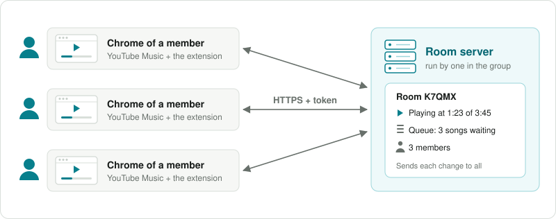

# Music Together

Listen to YouTube Music with friends: the same queue, at the same moment, each in their own Chrome.

Music Together is a Chrome extension and a small room server that you run yourself.
A host creates a room and shares its ID. Everyone in the room hears the same song at the same position.
Nothing is streamed: each person plays YouTube Music with their own account, and the extension keeps their player on the room's song and position.

**Documentation:** https://etak64n.github.io/musictogether/

Music Together is not affiliated with Google or YouTube. It relies on parts of YouTube Music that are not documented, so a change to YouTube Music can stop it from working.

## How it works



The extension in each Chrome keeps a connection to the room server, sends the member's changes as commands, and receives every change of the room as an event.
The room server keeps the queue of each room and a timeline: the position in the current song at a moment on its clock.
Each extension computes the position from the timeline, and moves its own player there.

## Features

- **Invite links.** The host copies a link that opens YouTube Music and joins the room.
- **Two shared queues.** Everyone in a room adds songs to Main, which plays first, or to Standby, which plays once Main is empty and mixes the songs that it gets at random places. Songs come from the search of the popup, from the ⋮ menu of a song, an album, or a playlist in YouTube Music, or by dragging one from YouTube Music to a place in the queues. The queues are reordered by dragging, and the songs that have played stay at the top in gray, ready to be added again.
- **Main as a playlist.** The songs of Main, those that played and those that wait, are saved as a private playlist of your YouTube Music with one click.
- **The same moment.** The room plays while anyone listens. Pausing stops your own player only, and playing again joins the room where it is now. Everyone sees who is listening.
- **A host.** The host decides whether participants may skip, seek, and reorder, and ends the room.
- **Your own server.** One Go program without dependencies keeps the rooms in JSON files, and answers only the people who know its token.
- **A mini window, a side panel, or a window on top.** The button opens the popup in a small window below it, or in the side panel of Chrome, which stays open while you move between tabs. A button in the top bar of YouTube Music opens it in a window that stays on top of the others. In YouTube Music installed as an app, the button opens the mini window.
- **English and Japanese.** The screens of the extension follow the language of Chrome, and its settings switch them between the two.

## Quick start

Run the room server on a machine with Docker:

```sh
git clone https://github.com/etak64n/musictogether.git
cd musictogether/server
cp .env.example .env    # then set TOKEN in .env
docker compose up -d
```

Compose runs the image `ghcr.io/etak64n/musictogether:latest`, for amd64 and arm64, and the server listens on 127.0.0.1:8080. Give it an HTTPS address with a reverse proxy or a tunnel, because the extension connects over HTTPS only.

Install the extension in Chrome:

1. Download [musictogether.zip](https://github.com/etak64n/musictogether/releases/latest/download/musictogether.zip), which is always the latest release, extract it, and move the folder `musictogether` to a place you keep.
2. Open `chrome://extensions`, turn on Developer mode, click Load unpacked, and choose the folder.
3. Click the gear in the popup of Music Together, and enter the address of the server and its token.

Open YouTube Music, create a room in the popup, and send its invite link to your friends.

## Configuration

The room server reads these environment variables. The first four are required:

| Variable | Description | Example |
| --- | --- | --- |
| `ADDR` | The host and port to listen on | `0.0.0.0:8080` |
| `DATA_DIR` | The directory that keeps the rooms | `/data` |
| `LOG_FORMAT` | The format of the logs: `json` or `text` | `json` |
| `TOKEN` | The token that the extension sends: at least 8 ASCII letters, digits, or symbols | `a-long-token-of-your-own` |
| `RELEASES_URL` | Optional. The latest release in the GitHub API, which the server checks every 10 minutes to tell the members of every room of a newer one | `https://api.github.com/repos/etak64n/musictogether/releases/latest` |

[Server configuration](https://etak64n.github.io/musictogether/settings/server/) describes the logs and the limits.

## License

[MIT](LICENSE)
