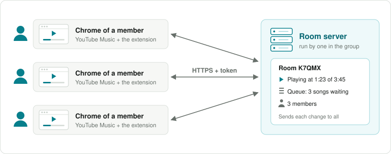

## Parts

Music Together consists of the room server and an extension in the Chrome of each member. The extension has five parts.

- The **popup** (extension/popup/) is the window that the button of the extension opens. It shows the room of a tab, and passes what the member does to that tab. It keeps no state of its own, so closing it changes nothing. Its equalizer moves while the member's own player plays, without measuring the sound.
- The **settings page** (extension/options/) keeps the language, the address of the room server, and the token in the storage of the extension.
- The **room script** (extension/content/room.js) runs in every tab of YouTube Music. Chrome runs it in an **isolated world**: it reads the document of the page, and its JavaScript variables are separate from those of the page. It keeps the connection to the room server, and decides what the player of the tab plays.
- The **page script** (extension/content/page.js) runs in the JavaScript world of the page of YouTube Music, where the player of YouTube Music is reachable. It drives the player for the room script, and reports what the player does. The two scripts exchange JSON in DOM events, because a DOM event reaches both worlds.
- The **service worker** (extension/background.js) remembers which tab is in a room, so that the popup finds that tab and a reloaded tab joins its room again. It also shows the number of songs in Up next on the button.

The **room server** (server/) keeps the rooms, takes the commands of the members, and sends every change of a room to every member of it.

## The connection to a room

A member joins a room with a request that stays open: `POST /api/rooms/{id}/stream`.
The response is an **event stream**: a response that the server keeps writing to, one event at a time.
The first event, `hello`, gives the member a session ID. Every later event, `room`, carries the whole room: its queue, its timeline, and its members.
A member changes the room with a separate request per change, `POST /api/rooms/{id}/commands`, which carries the session ID.
When the stream breaks, the room script opens a new one after 1, 2, 4, 8, 15, and then every 30 seconds.

The room server sends the whole room in every `room` event, because a room is small: at most 200 songs and 50 connections. A member who misses an event still has the whole room at the next one.

## The timeline of a room

The room server keeps the position in the current song as a **timeline** of three values:

| Value | Meaning |
| --- | --- |
| `position` | The position in the song, in seconds, at the moment `updatedAt`. |
| `updatedAt` | A moment on the clock of the server, in milliseconds. |
| `playing` | Whether the position moves forward from that moment. |

While `playing` is true, the position at a moment `t` is `position + (t - updatedAt) / 1000`.
The room server changes the three values only when something happens to the room, such as a seek, a new song, or the last listener pausing. Between those events, every member computes the same position from the same values, so the room server sends nothing while a song plays.

## The clock of the server

The timeline uses the clock of the server, and the clock of each browser can differ from it by seconds. The room script measures the difference in five requests to `GET /api/time`:

1. For each request, the room script notes the time on its own clock when it sends the request and when the answer arrives.
2. It takes the time in the answer as the time halfway between the two. The error of this estimate is at most half of the round trip, so a shorter round trip gives a smaller error.
3. It keeps the difference from the request with the shortest round trip.

The room script measures again every 10 minutes while it is in a room.

## Following the timeline

Whenever the room or the player changes, the room script compares them and corrects the player through the page script:

- When the player is on another song than the room's, the page script loads the room's song. It uses the same navigation as a click on a song in YouTube Music, so the screen of YouTube Music shows the song.
- When the player is more than 1 second away from the timeline while the room plays, or 0.5 seconds while it is paused, the page script seeks to the room's position. Right after a song loads, the room script lines it up to within 0.25 seconds.
- When the room plays and the player has not started for 5 seconds, the popup asks the member to click the page, because Chrome plays sound only in a page that has been clicked.

## The end of a song

When a song ends, YouTube Music moves on to a song of its own choosing. The page script pauses the player 0.3 seconds before the end, so that the room decides what plays next.
The room script then sends the command `ended` with the ID of the room's current item.
Any member can send `ended`, so the room server accepts it only within 5 seconds of the end of the song on the timeline.
The command names the item, so several members who send it for the same song move the room on once.

## Listening

Each connection to a room has a **listening** flag, which is true while the member's own player plays.
Pausing, in the popup or in YouTube Music, sets the flag to false, and the room script stops correcting the player.
Playing sets the flag to true, and the player moves to the room's current position.
The room server moves the timeline while at least one connection of the room is listening, and stops it when the last one stops listening.
When every listening member disconnects, the room server waits 30 seconds before it stops the timeline, so that a member who reconnects at once finds the room playing.

## The menu item

The page script adds Add to Music Together to the menu of a song in YouTube Music, after the item Add to queue.
YouTube Music builds every menu in one shared element, whose data names the song of the menu. The page script reads the ID of the song from that data, and places the item while the tab is in a room.

## Storage of rooms

The room server writes a room to a JSON file in `DATA_DIR/rooms/` after every change.
It writes a temporary file first and renames it over the old one, so that a crash leaves the old file or the new one whole.
When it starts, it reads every file back.
Every 10 minutes, it deletes the rooms that nobody has joined or changed for 7 days.

## The token

The room server hashes the header `Authorization` and the expected value with SHA-256, and compares the two hashes in constant time.
The comparison then takes the same time whatever the header holds, so its duration tells nothing about the token.
